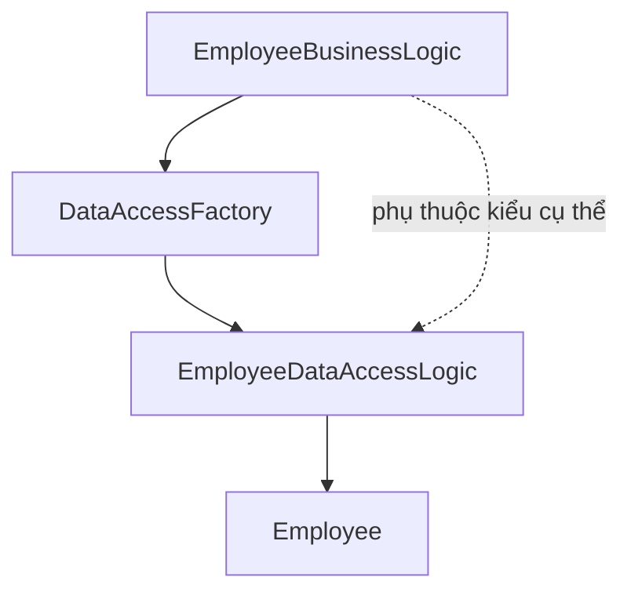
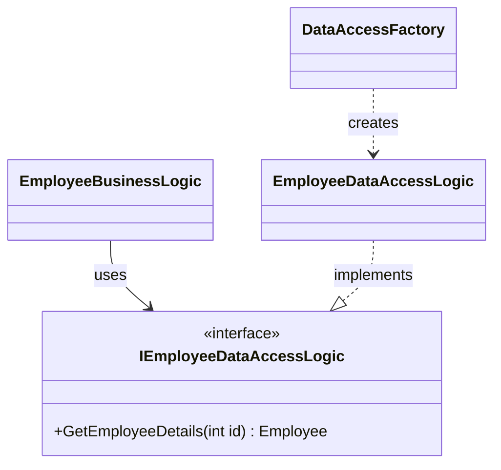
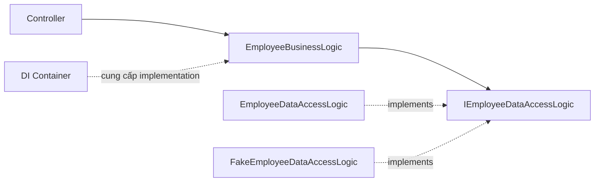
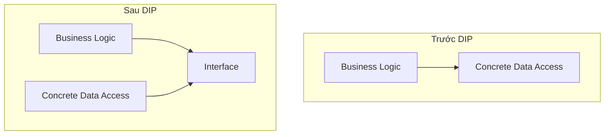

# SOLID – Phần 5: Dependency Inversion Principle (DIP) trong C#

> **Module cấp cao không nên phụ thuộc trực tiếp vào module cấp thấp. Cả hai nên phụ thuộc vào abstraction. Abstraction không phụ thuộc vào chi tiết; chi tiết phụ thuộc vào abstraction.**

## 1. Hiểu đơn giản

Trong ví dụ quản lý nhân viên:

- **EmployeeBusinessLogic**: module cấp cao, xử lý nghiệp vụ.
- **EmployeeDataAccessLogic**: module cấp thấp, truy xuất dữ liệu (ví dụ sử dụng dữ liệu hard-code thay cho database).
- **IEmployeeDataAccessLogic**: hợp đồng cho thao tác lấy nhân viên.

DIP giúp logic nghiệp vụ không phải biết dữ liệu đến từ SQL, API hay bộ nhớ.

## 2. Trước khi áp dụng DIP



```csharp
public class Employee
{
    public int ID { get; set; }
    public string Name { get; set; } = "";
    public string Department { get; set; } = "";
    public int Salary { get; set; }
}

public class EmployeeDataAccessLogic
{
    public Employee GetEmployeeDetails(int id) => new()
    {
        ID = id, Name = "Pranaya", Department = "IT", Salary = 10000
    };
}

public static class DataAccessFactory
{
    public static EmployeeDataAccessLogic GetEmployeeDataAccessObj()
        => new EmployeeDataAccessLogic();
}

public class EmployeeBusinessLogic
{
    private readonly EmployeeDataAccessLogic _dataAccess =
        DataAccessFactory.GetEmployeeDataAccessObj();

    public Employee GetEmployeeDetails(int id)
        => _dataAccess.GetEmployeeDetails(id);
}
```

**Vấn đề:** `EmployeeBusinessLogic` biết trực tiếp `EmployeeDataAccessLogic`. Muốn đổi sang một implementation khác, mã nghiệp vụ hoặc factory có thể phải thay đổi. Factory chỉ chuyển nơi khởi tạo đối tượng, chưa xóa phụ thuộc vào kiểu cụ thể.

## 3. Sau khi áp dụng DIP – sử dụng abstraction

Tạo interface mô tả hành vi cần dùng:

```csharp
public interface IEmployeeDataAccessLogic
{
    Employee GetEmployeeDetails(int id);
}

public class EmployeeDataAccessLogic : IEmployeeDataAccessLogic
{
    public Employee GetEmployeeDetails(int id) => new()
    {
        ID = id, Name = "Pranaya", Department = "IT", Salary = 10000
    };
}

public static class DataAccessFactory
{
    public static IEmployeeDataAccessLogic GetEmployeeDataAccessObj()
        => new EmployeeDataAccessLogic();
}

public class EmployeeBusinessLogic
{
    private readonly IEmployeeDataAccessLogic _dataAccess;

    public EmployeeBusinessLogic()
    {
        _dataAccess = DataAccessFactory.GetEmployeeDataAccessObj();
    }

    public Employee GetEmployeeDetails(int id)
        => _dataAccess.GetEmployeeDetails(id);
}
```



**Điểm thay đổi:** Business Logic giữ một biến kiểu interface, không còn gọi trực tiếp phương thức trên kiểu `EmployeeDataAccessLogic`. Lớp data access thực thi hợp đồng do interface quy định.

**Điểm cần lưu ý:** Business Logic vẫn gọi `DataAccessFactory` cụ thể trong constructor. Để dễ thay thế dependency và unit test hơn, có thể chuyển việc tạo dependency ra bên ngoài.

## 4. Cách thường dùng trong .NET: Constructor Injection

Trong ASP.NET Core, Constructor Injection là cách phổ biến để cung cấp dependency từ bên ngoài.

```csharp
public class EmployeeBusinessLogic
{
    private readonly IEmployeeDataAccessLogic _dataAccess;

    public EmployeeBusinessLogic(IEmployeeDataAccessLogic dataAccess)
    {
        _dataAccess = dataAccess;
    }

    public Employee GetEmployeeDetails(int id)
        => _dataAccess.GetEmployeeDetails(id);
}
```

Đăng ký dependency trong ASP.NET Core:

```csharp
builder.Services.AddScoped<IEmployeeDataAccessLogic, EmployeeDataAccessLogic>();
builder.Services.AddScoped<EmployeeBusinessLogic>();
```



Khi cần test, có thể truyền một fake thay cho data access thật:

```csharp
public class FakeEmployeeDataAccessLogic : IEmployeeDataAccessLogic
{
    public Employee GetEmployeeDetails(int id)
        => new() { ID = id, Name = "Test", Department = "QA", Salary = 100 };
}

var service = new EmployeeBusinessLogic(new FakeEmployeeDataAccessLogic());
Console.WriteLine(service.GetEmployeeDetails(1).Name); // Test
```

## 5. DIP khác DI và IoC thế nào?

| Khái niệm | Ý nghĩa |
|---|---|
| **DIP** | Nguyên lý thiết kế: code cấp cao phụ thuộc abstraction, không phụ thuộc trực tiếp implementation cấp thấp |
| **DI (Dependency Injection)** | Kỹ thuật cung cấp dependency từ bên ngoài, chẳng hạn qua constructor |
| **IoC (Inversion of Control)** | Khái niệm rộng hơn về chuyển quyền kiểm soát khởi tạo/điều phối ra ngoài đối tượng |

**DIP không bắt buộc phải dùng DI container.** Có thể áp dụng DIP bằng cách tự truyền implementation qua constructor.

## 6. Điều gì thực sự được đảo ngược?

Trước DIP, dependency trong source đi từ Business Logic đến implementation cụ thể của Data Access. Sau DIP, Business Logic phụ thuộc vào hợp đồng, còn Data Access triển khai hợp đồng đó.



Điều này không có nghĩa luồng gọi runtime bị đảo ngược: Business Logic vẫn gọi thao tác lấy dữ liệu. **Thứ đảo ngược là hướng phụ thuộc ở mức thiết kế/source code.**

## 7. Lợi ích và giới hạn

- Giảm coupling giữa nghiệp vụ và chi tiết truy xuất dữ liệu.
- Thay implementation (database, API, fake) mà không sửa Business Logic nếu hợp đồng được giữ nguyên.
- Dễ unit test, phát triển song song và bảo trì.
- Không nên tạo interface máy móc cho mọi class: abstraction nên có mục đích rõ ràng, ổn định và được sử dụng thực tế.

## 8. Tổng kết

**DIP = Business Logic phụ thuộc vào hợp đồng, không phụ thuộc vào cách hợp đồng được thực hiện.**

Trong ví dụ `EmployeeBusinessLogic`, điểm mấu chốt là đổi phụ thuộc từ `EmployeeDataAccessLogic` sang `IEmployeeDataAccessLogic`. Constructor Injection tiếp tục giúp tách cả việc khởi tạo implementation khỏi Business Logic.
