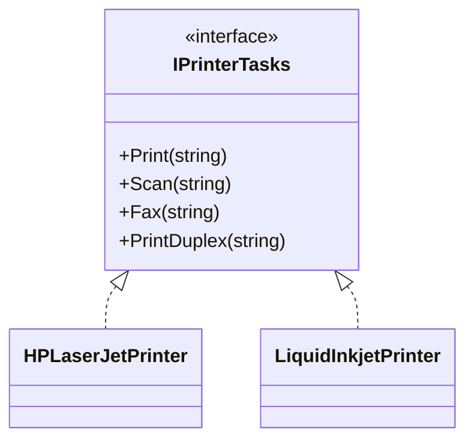
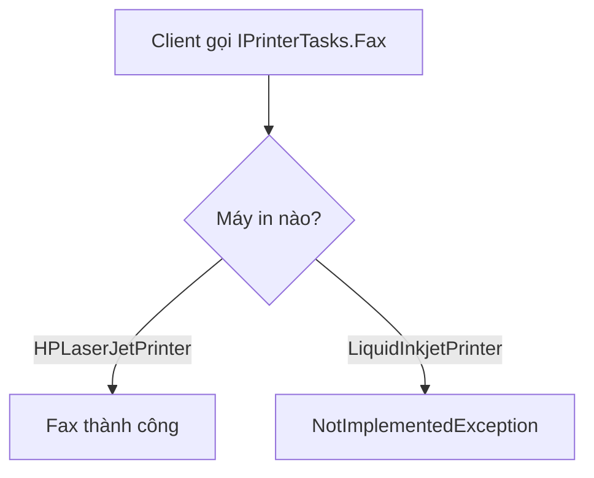
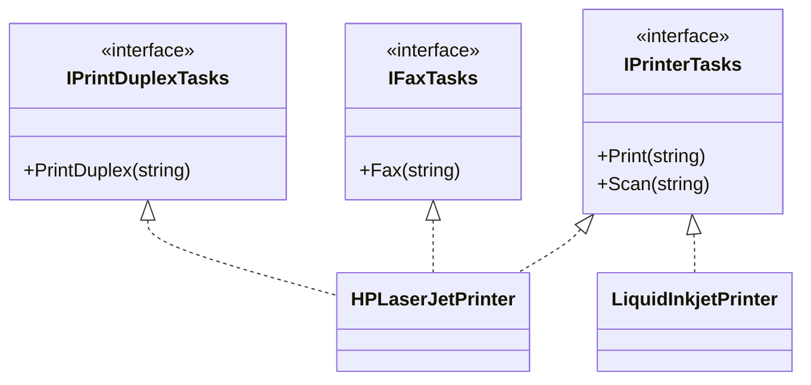
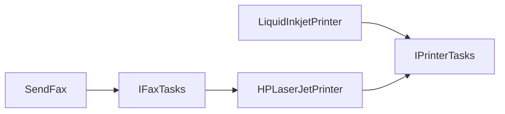

# Interface Segregation Principle (ISP) trong C#

> **SOLID — Nguyên lý thứ 4:** Client không nên bị buộc phụ thuộc vào các phương thức mà nó không sử dụng.

## 1. ISP là gì?

Interface Segregation Principle (ISP) khuyên chúng ta thiết kế **interface tập trung vào nhu cầu của từng nhóm client**, thay vì gom mọi khả năng vào một interface quá lớn (*fat interface*).

Ở đây, *client* có thể là class triển khai interface **hoặc** code sử dụng interface. Mục tiêu không đơn giản là làm interface càng ít method càng tốt, mà là **tránh những phụ thuộc không cần thiết**.

## 2. Ví dụ vi phạm ISP: Máy in

Giả sử có hai loại máy in:

- `HPLaserJetPrinter`: in, quét, fax và in hai mặt.
- `LiquidInkjetPrinter`: chỉ in và quét.

Nhưng hệ thống định nghĩa một interface chứa cả bốn chức năng:

```csharp
public interface IPrinterTasks
{
    void Print(string content);
    void Scan(string content);
    void Fax(string content);
    void PrintDuplex(string content);
}
```



Máy in `LiquidInkjetPrinter` không hỗ trợ fax hay in hai mặt nhưng vẫn phải triển khai các method đó:

```csharp
public class LiquidInkjetPrinter : IPrinterTasks
{
    public void Print(string content) => Console.WriteLine("Printed");
    public void Scan(string content) => Console.WriteLine("Scanned");

    public void Fax(string content) => throw new NotImplementedException();
    public void PrintDuplex(string content) => throw new NotImplementedException();
}
```

**Vấn đề:** Chữ ký interface hứa rằng máy in có thể `Fax()` và `PrintDuplex()`, nhưng khi client gọi sẽ gặp lỗi. Việc thêm/chỉnh sửa các chức năng này cũng có thể buộc những class không liên quan phải thay đổi.



## 3. Thiết kế lại theo ISP

Chia interface theo các nhóm khả năng trong hệ thống:

```csharp
public interface IPrinterTasks
{
    void Print(string content);
    void Scan(string content);
}

public interface IFaxTasks
{
    void Fax(string content);
}

public interface IPrintDuplexTasks
{
    void PrintDuplex(string content);
}
```

Class nào cần khả năng nào thì triển khai interface tương ứng:

```csharp
public class HPLaserJetPrinter : IPrinterTasks, IFaxTasks, IPrintDuplexTasks
{
    public void Print(string content) => Console.WriteLine("Printed");
    public void Scan(string content) => Console.WriteLine("Scanned");
    public void Fax(string content) => Console.WriteLine("Faxed");
    public void PrintDuplex(string content) => Console.WriteLine("Duplex printed");
}

public class LiquidInkjetPrinter : IPrinterTasks
{
    public void Print(string content) => Console.WriteLine("Printed");
    public void Scan(string content) => Console.WriteLine("Scanned");
}
```



Giờ đây, `LiquidInkjetPrinter` **không cần khai báo những method mà thiết bị không hỗ trợ**. Code chỉ cần fax cũng có thể nhận `IFaxTasks` thay vì phụ thuộc vào cả interface máy in.

## 4. Nhìn từ phía client — điểm quan trọng nhất

```csharp
public static void SendFax(IFaxTasks faxDevice, string content)
{
    faxDevice.Fax(content);
}

var hp = new HPLaserJetPrinter();
SendFax(hp, "Invoice"); // Hợp lệ

var inkjet = new LiquidInkjetPrinter();
// SendFax(inkjet, "Invoice"); // Lỗi compile: không triển khai IFaxTasks
```

So với thiết kế cũ, lỗi **được ngăn ngay tại compile-time** thay vì chờ `NotImplementedException` ở runtime. Client `SendFax` chỉ phụ thuộc vào hợp đồng `IFaxTasks` mà nó thực sự cần.



## 5. Lợi ích và giới hạn

| Trước ISP | Sau ISP |
|---|---|
| Một interface chứa nhiều khả năng | Các interface theo nhóm chức năng |
| Class phải viết method không hỗ trợ | Class chỉ triển khai khả năng phù hợp |
| Có thể ném `NotImplementedException` khi gọi | Client không thể gọi chức năng không được khai báo trong interface |
| Client phụ thuộc vào nhiều method không cần | Client phụ thuộc vào hợp đồng nhỏ, tập trung |

**Không nên hiểu ISP là “mỗi method một interface”.** Nếu `Print()` và `Scan()` luôn được dùng chung trong cùng một nhóm client, việc giữ chúng trong `IPrinterTasks` có thể hợp lý trong thiết kế này. Nếu thực tế có máy chỉ in mà không quét, lúc đó có thể cân nhắc tách thêm `IPrintTasks` và `IScanTasks`.

## 6. Phân biệt ISP và LSP

- **ISP:** Thiết kế interface sao cho client không phải phụ thuộc vào chức năng không cần.
- **LSP:** Đối tượng triển khai/kiểu con phải thực hiện đúng hợp đồng hành vi mà client kỳ vọng khi thay thế.

Trong ví dụ cũ, `LiquidInkjetPrinter` bị ép implement `Fax()` là dấu hiệu thiết kế vi phạm **ISP**. Việc `Fax()` ném `NotImplementedException` khi client tin rằng mọi `IPrinterTasks` đều fax được cũng cho thấy vấn đề về **hợp đồng hành vi**, liên quan đến tư duy **LSP**.

## 7. Ghi nhớ

> **ISP = Chỉ phụ thuộc vào những khả năng mình thực sự cần.**

Thiết kế interface tốt không đo bằng số lượng method ít nhất, mà bằng việc mỗi client nhìn thấy một hợp đồng rõ ràng, phù hợp với trách nhiệm và khả năng thực tế của đối tượng.
