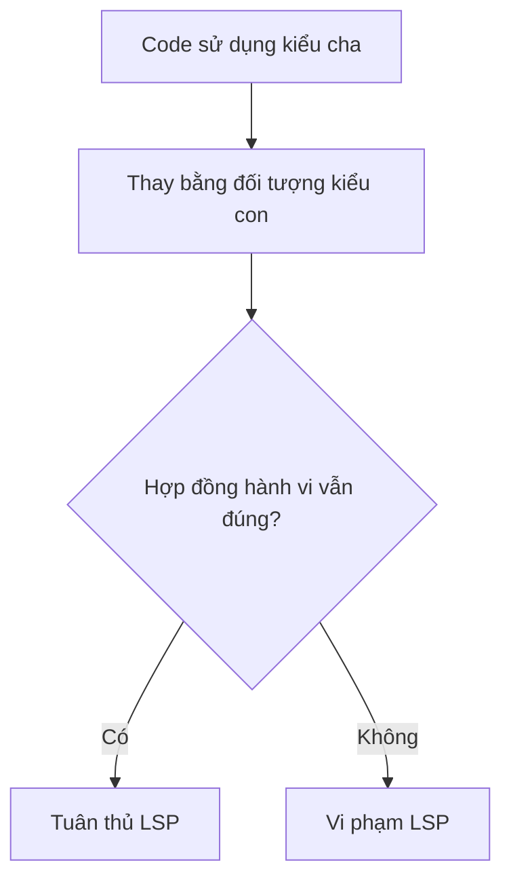
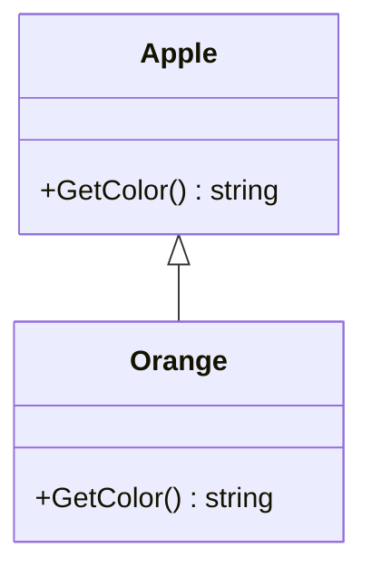
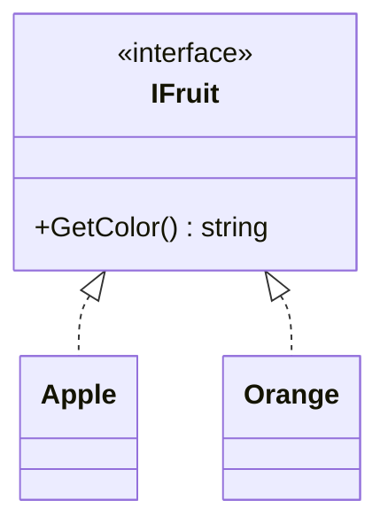
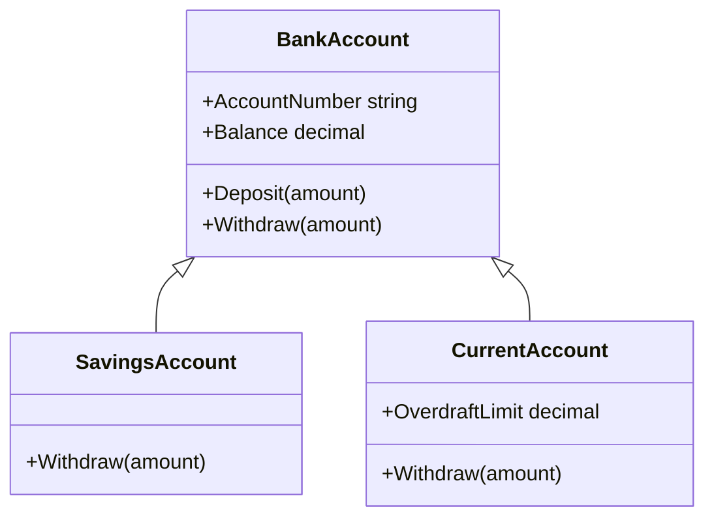
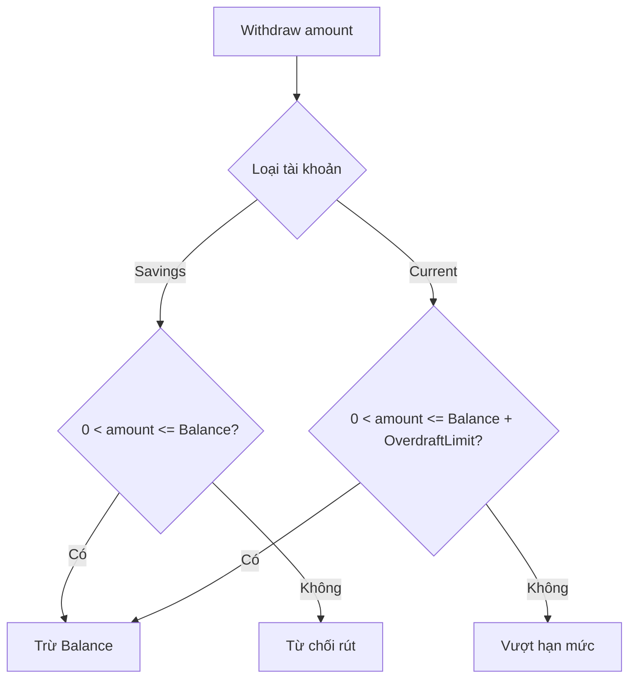
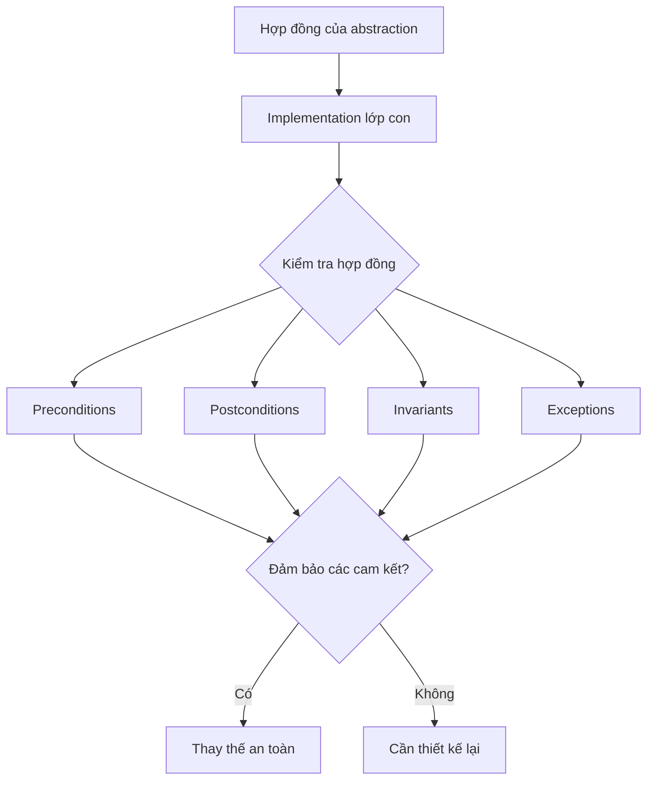
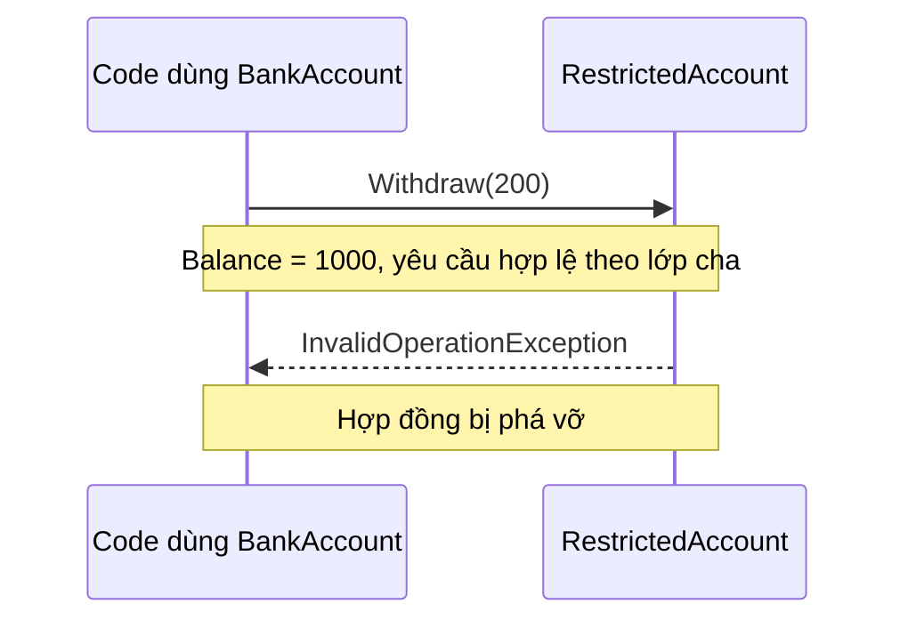
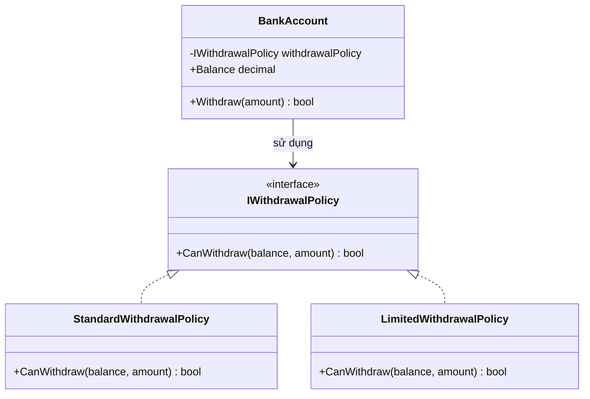
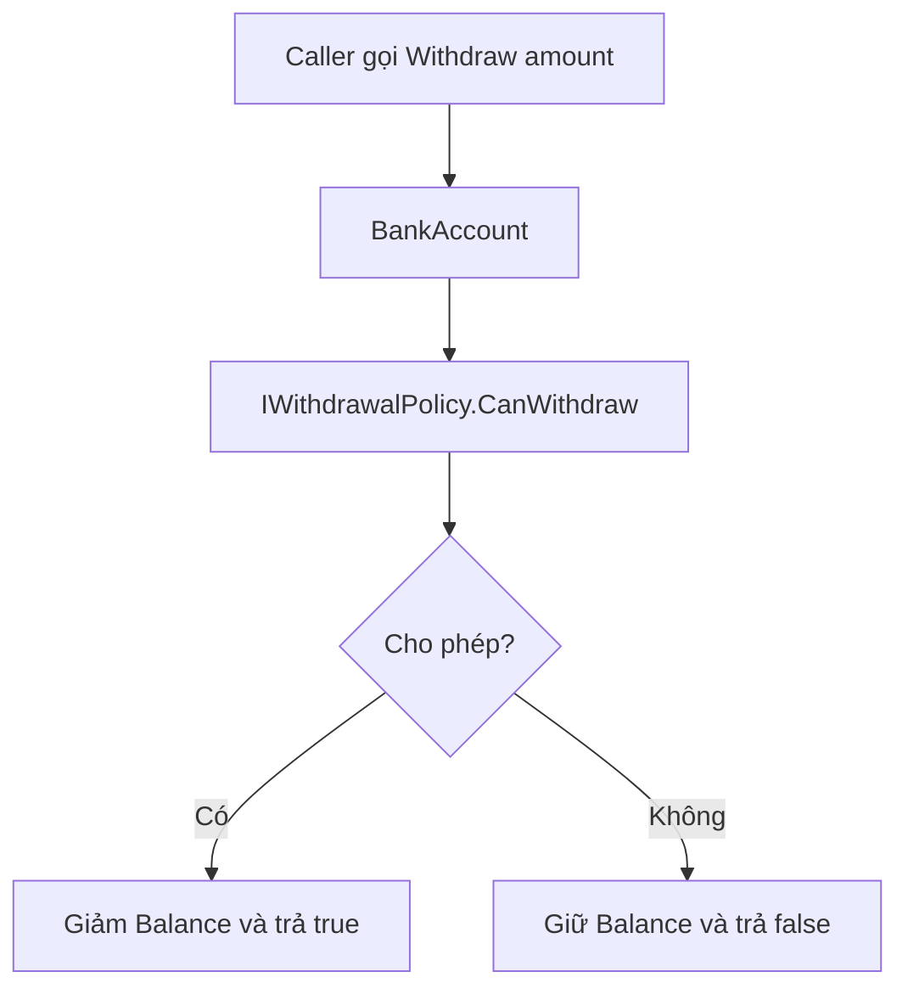

# Liskov Substitution Principle (LSP) trong C#

> **LSP — chữ L trong SOLID:** Một đối tượng lớp con phải thay thế được đối tượng lớp cha mà không phá vỡ hợp đồng hành vi mà code sử dụng lớp cha đang dựa vào.

## Mục lục

1. [LSP là gì?](#1-lsp-là-gì)
2. [Ví dụ Apple và Orange](#2-ví-dụ-apple-và-orange)
3. [Ví dụ BankAccount](#3-ví-dụ-bankaccount)
4. [Hợp đồng hành vi](#4-hợp-đồng-hành-vi)
5. [Ví dụ vi phạm LSP](#5-ví-dụ-vi-phạm-lsp)
6. [Cải thiện bằng Composition](#6-cải-thiện-bằng-composition)
7. [Khi nào cần áp dụng?](#7-khi-nào-cần-áp-dụng)
8. [Tổng kết](#8-tổng-kết)

## 1. LSP là gì?

Liskov Substitution Principle yêu cầu mọi lớp con giữ đúng những cam kết mà lớp cha hoặc interface đưa ra. Kế thừa hợp lệ về cú pháp **không đồng nghĩa** với thay thế an toàn về hành vi.



## 2. Ví dụ Apple và Orange

### 2.1. Thiết kế không phù hợp về mặt mô hình

```csharp
public class Apple
{
    public virtual string GetColor() => "Red";
}

public class Orange : Apple
{
    public override string GetColor() => "Orange";
}

Apple apple = new Orange();
Console.WriteLine(apple.GetColor()); // Orange
```

- `virtual`: Cho phép lớp con ghi đè phương thức.
- `override`: Cung cấp phiên bản triển khai của lớp con.
- `Apple apple = new Orange()` biên dịch được nhưng mô hình hóa sai quan hệ **is-a**: cam không phải táo.



**Lưu ý:** Việc `GetColor()` trả về `"Orange"` thay vì `"Red"` không tự động chứng minh vi phạm LSP. Điều quyết định là hợp đồng của `Apple` có cam kết trả về màu đỏ hay không.

### 2.2. Thiết kế phù hợp hơn với IFruit

```csharp
public interface IFruit
{
    string GetColor();
}

public class Apple : IFruit
{
    public string GetColor() => "Red";
}

public class Orange : IFruit
{
    public string GetColor() => "Orange";
}

IFruit fruit = new Orange();
Console.WriteLine(fruit.GetColor()); // Orange

fruit = new Apple();
Console.WriteLine(fruit.GetColor()); // Red
```



`IFruit` chỉ cam kết cung cấp màu của trái cây, không yêu cầu mọi loại trái cây có cùng màu.

## 3. Ví dụ BankAccount

Giả sử hệ thống có tài khoản tiết kiệm (`SavingsAccount`) và tài khoản thanh toán cho phép thấu chi (`CurrentAccount`).

```csharp
public class BankAccount
{
    public string AccountNumber { get; }
    public decimal Balance { get; protected set; }

    public BankAccount(string accountNumber, decimal balance)
    {
        AccountNumber = accountNumber;
        Balance = balance;
    }

    public virtual void Deposit(decimal amount)
    {
        if (amount <= 0) throw new ArgumentOutOfRangeException(nameof(amount));
        Balance += amount;
    }

    public virtual void Withdraw(decimal amount)
    {
        if (amount <= 0 || amount > Balance)
        {
            Console.WriteLine("Invalid withdrawal amount.");
            return;
        }
        Balance -= amount;
    }
}

public class SavingsAccount : BankAccount
{
    public SavingsAccount(string number, decimal balance)
        : base(number, balance) { }

    public override void Withdraw(decimal amount) => base.Withdraw(amount);
}

public class CurrentAccount : BankAccount
{
    public decimal OverdraftLimit { get; }

    public CurrentAccount(string number, decimal balance, decimal overdraftLimit)
        : base(number, balance)
    {
        if (overdraftLimit < 0) throw new ArgumentOutOfRangeException(nameof(overdraftLimit));
        OverdraftLimit = overdraftLimit;
    }

    public override void Withdraw(decimal amount)
    {
        if (amount <= 0 || amount > Balance + OverdraftLimit)
        {
            Console.WriteLine("Overdraft limit exceeded.");
            return;
        }
        Balance -= amount;
    }
}
```



### Luồng rút tiền



```csharp
BankAccount savings = new SavingsAccount("SA001", 1000m);
savings.Withdraw(500m);
Console.WriteLine(savings.Balance); // 500

BankAccount current = new CurrentAccount("CA001", 1500m, 500m);
current.Withdraw(2000m);
Console.WriteLine(current.Balance); // -500
```

| Tài khoản | Số dư đầu | Số tiền rút | Hạn mức thấu chi | Kết quả |
|---|---:|---:|---:|---|
| Savings | 1.000 | 500 | 0 | Thành công, còn 500 |
| Current | 1.500 | 2.000 | 500 | Thành công, còn -500 |
| Savings | 1.000 | 1.200 | 0 | Bị từ chối |

**Đánh giá LSP:** Nếu hợp đồng `BankAccount` cam kết số dư không bao giờ âm, `CurrentAccount` phá vỡ bất biến đó. Nếu abstraction cho phép thấu chi theo chính sách được công bố, hành vi có thể hợp lệ. Vì vậy phải xác định hợp đồng trước khi kết luận.

## 4. Hợp đồng hành vi

| Thành phần | Câu hỏi kiểm tra |
|---|---|
| **Precondition** (tiền điều kiện) | Lớp con có yêu cầu đầu vào nghiêm ngặt hơn lớp cha không? |
| **Postcondition** (hậu điều kiện) | Lớp con có đảm bảo kết quả mà lớp cha cam kết không? |
| **Invariant** (bất biến) | Lớp con có giữ các quy tắc trạng thái chung không? |
| **Exceptions** (ngoại lệ) | Lớp con có bất ngờ từ chối thao tác hợp lệ theo hợp đồng không? |



## 5. Ví dụ vi phạm LSP

**Hợp đồng:** Với số dư đủ, mọi số tiền dương không vượt quá số dư phải rút được.

```csharp
public abstract class BankAccount
{
    public decimal Balance { get; protected set; }

    protected BankAccount(decimal balance) => Balance = balance;

    public virtual void Withdraw(decimal amount)
    {
        if (amount <= 0 || amount > Balance)
            throw new ArgumentOutOfRangeException(nameof(amount));

        Balance -= amount;
    }
}

public class RestrictedAccount : BankAccount
{
    public RestrictedAccount(decimal balance) : base(balance) { }

    public override void Withdraw(decimal amount)
    {
        if (amount > 100)
            throw new InvalidOperationException("Maximum withdrawal is 100");

        base.Withdraw(amount);
    }
}

BankAccount account = new RestrictedAccount(1000);
account.Withdraw(200); // InvalidOperationException
```

`RestrictedAccount` bổ sung điều kiện `amount <= 100` mà lớp cha không yêu cầu. Người gọi sử dụng `BankAccount` có quyền kỳ vọng rút 200 từ số dư 1.000 thành công, nên đây là **vi phạm LSP**.



## 6. Cải thiện bằng Composition

Thay vì ghi đè `Withdraw()` với các điều kiện ngầm khác nhau, tách chính sách rút tiền thành `IWithdrawalPolicy` và công khai kết quả thành công/thất bại.

```csharp
public interface IWithdrawalPolicy
{
    bool CanWithdraw(decimal balance, decimal amount);
}

public sealed class StandardWithdrawalPolicy : IWithdrawalPolicy
{
    public bool CanWithdraw(decimal balance, decimal amount)
        => amount > 0 && amount <= balance;
}

public sealed class LimitedWithdrawalPolicy : IWithdrawalPolicy
{
    public bool CanWithdraw(decimal balance, decimal amount)
        => amount > 0 && amount <= balance && amount <= 100;
}

public class BankAccount
{
    public decimal Balance { get; private set; }
    private readonly IWithdrawalPolicy _withdrawalPolicy;

    public BankAccount(decimal balance, IWithdrawalPolicy withdrawalPolicy)
    {
        Balance = balance;
        _withdrawalPolicy = withdrawalPolicy ?? throw new ArgumentNullException(nameof(withdrawalPolicy));
    }

    // Contract: trả false khi chính sách không cho phép rút.
    public bool Withdraw(decimal amount)
    {
        if (!_withdrawalPolicy.CanWithdraw(Balance, amount))
            return false;

        Balance -= amount;
        return true;
    }
}

var standard = new BankAccount(1000m, new StandardWithdrawalPolicy());
Console.WriteLine(standard.Withdraw(200m)); // True

var limited = new BankAccount(1000m, new LimitedWithdrawalPolicy());
Console.WriteLine(limited.Withdraw(200m)); // False
```

> Các đoạn code ở từng mục là ví dụ độc lập. Một số lớp có cùng tên (`BankAccount`) nhằm so sánh thiết kế, không nên đặt tất cả vào cùng namespace trong một file để biên dịch.





**Lợi ích:** Hợp đồng của `BankAccount.Withdraw` minh bạch: chính sách có thể từ chối giao dịch, và người gọi nhận `bool` để xử lý. Các chính sách khác nhau được truyền qua composition thay vì phá vỡ hợp đồng của lớp cha.

## 7. Khi nào cần áp dụng?

LSP đặc biệt hữu ích khi thiết kế class hierarchy, interface, dependency injection, strategy pattern và những module có nhiều implementation.

Hãy kiểm tra:

1. Lớp con có thực sự phù hợp với ý nghĩa của lớp cha không?
2. Lớp con có yêu cầu thêm điều kiện đầu vào không?
3. Lớp con có đảm bảo các kết quả đã cam kết không?
4. Lớp con có giữ các bất biến chung không?
5. Code gọi qua kiểu cha có hoạt động đúng khi thay bằng lớp con không?

## 8. Tổng kết

| Khái niệm | Ý nghĩa |
|---|---|
| Inheritance | Kế thừa cấu trúc và hành vi |
| Polymorphism | Các implementation có thể thực hiện hành vi khác nhau |
| LSP | Thay thế an toàn mà không phá vỡ hợp đồng |
| Behavioral Contract | Cam kết về đầu vào, kết quả, trạng thái và lỗi |
| Composition | Xây dựng hành vi bằng cách kết hợp các đối tượng |

**Ghi nhớ:** LSP không bắt mọi lớp con hoạt động giống hệt lớp cha. LSP yêu cầu lớp con **giữ đúng các cam kết của abstraction**.

---

*Tài liệu học tập C# / SOLID. Các sơ đồ Mermaid được GitHub hỗ trợ hiển thị trực tiếp trong Markdown.*
