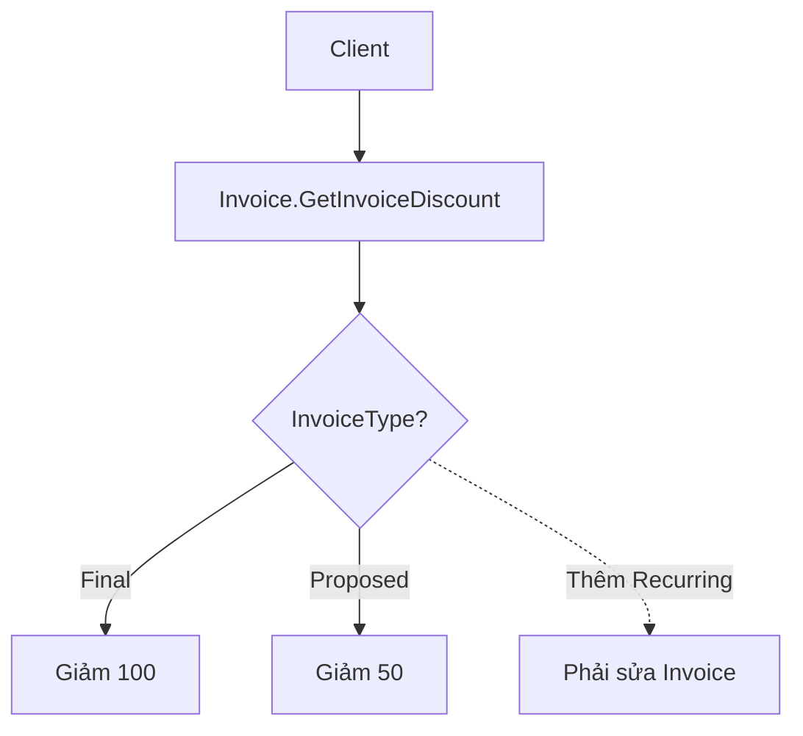
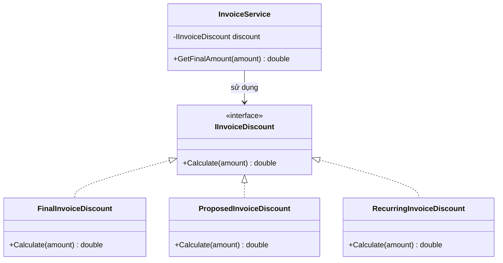
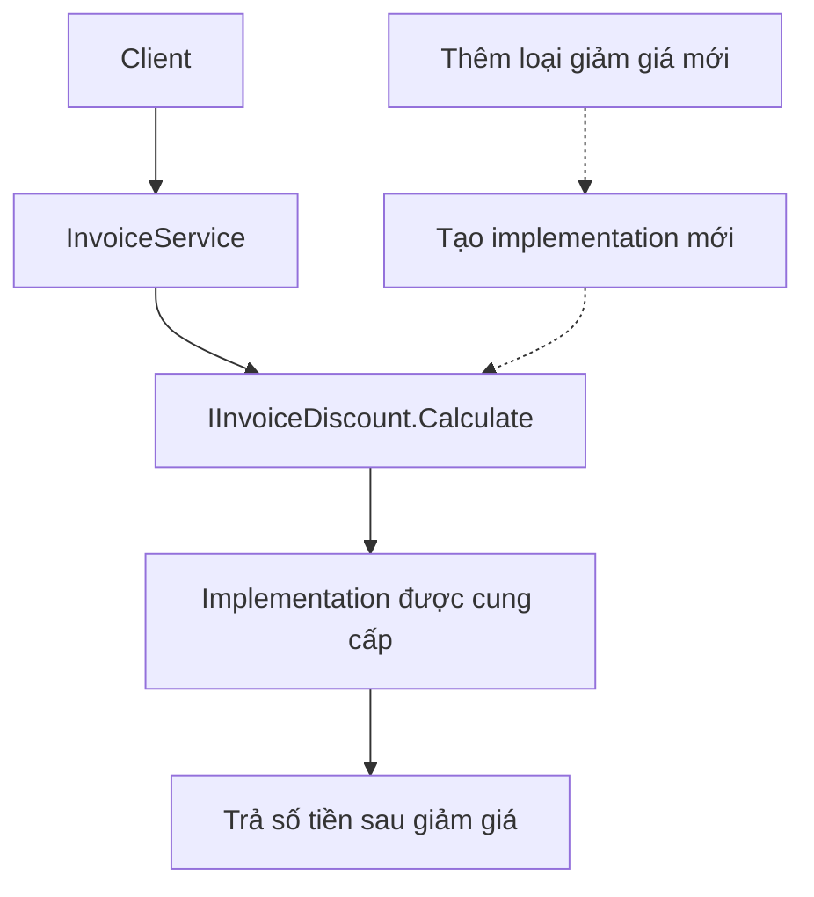

# Open-Closed Principle (OCP)

## 1. Khái niệm

Open-Closed Principle (OCP) là nguyên tắc thứ hai trong nhóm SOLID, áp dụng trong thiết kế phần mềm hướng đối tượng.

OCP phát biểu rằng:

> Các thành phần phần mềm (class, module, function) nên **mở để mở rộng (open for extension)** nhưng **đóng để sửa đổi (closed for modification)**.

Nói cách khác, khi có yêu cầu nghiệp vụ mới, nên có khả năng bổ sung hành vi bằng cách viết thêm thành phần mới thay vì liên tục chỉnh sửa logic đã ổn định.

Điều này **không có nghĩa là tuyệt đối không được sửa code cũ**. Khi có lỗi, thay đổi hợp đồng hoặc cần tái cấu trúc, việc sửa đổi vẫn cần thiết.

Mục tiêu của OCP là giảm rủi ro ảnh hưởng đến chức năng hiện có khi hệ thống phát triển.

## 2. Extension và Modification là gì?

- **Extension (mở rộng):** Bổ sung hành vi mới thông qua class mới, implementation mới hoặc cơ chế mở rộng đã thiết kế sẵn.
- **Modification (sửa đổi):** Thay đổi trực tiếp logic trong thành phần hiện có để đáp ứng yêu cầu mới.

Ví dụ, hệ thống đang tính giảm giá cho hai loại hóa đơn: `FinalInvoice` và `ProposedInvoice`. Khi xuất hiện `RecurringInvoice`, một thiết kế theo OCP cho phép thêm cách tính mới mà không cần sửa thuật toán của hai loại hóa đơn cũ.

## 3. Cách áp dụng OCP

### Bước 1: Xác định phần có khả năng thay đổi

Phân tích những quy tắc nghiệp vụ có thể phát sinh biến thể, chẳng hạn cách tính chiết khấu theo từng loại hóa đơn.

### Bước 2: Xây dựng abstraction phù hợp

Sử dụng interface hoặc abstract class để mô tả hành vi chung, thay vì để logic nghiệp vụ phụ thuộc vào từng loại cụ thể.

### Bước 3: Mở rộng bằng implementation mới

Mỗi biến thể cung cấp cách thực hiện riêng. Thành phần sử dụng chỉ làm việc thông qua abstraction.

**Lưu ý:** Không cần tạo interface cho mọi class. Chỉ nên tạo điểm mở rộng khi có nhu cầu biến đổi thực tế hoặc dự kiến hợp lý.

## 4. Dấu hiệu vi phạm OCP

Một class có thể đang vi phạm OCP khi:

- Mỗi lần thêm một loại nghiệp vụ mới đều phải sửa chuỗi `if/else` hoặc `switch` trong cùng một method.
- Class phụ thuộc trực tiếp vào nhiều implementation cụ thể.
- Thêm tính năng mới làm thay đổi các nhánh xử lý cũ dù chúng không đổi yêu cầu.
- Logic cho nhiều biến thể liên tục được gom vào một class ngày càng lớn.

### Hệ quả

- Tăng nguy cơ gây lỗi hồi quy khi thêm tính năng.
- Khó kiểm thử độc lập từng biến thể.
- Code trở nên phức tạp khi số trường hợp tăng lên.
- Khó mở rộng và bảo trì lâu dài.

> Không phải mọi `if/else` đều vi phạm OCP. Vấn đề nằm ở việc một điểm xử lý ổn định phải liên tục sửa khi xuất hiện các biến thể mới.

## 5. Thiết kế theo OCP

Giả sử hệ thống tính số tiền còn lại sau khi giảm giá cho từng loại hóa đơn.

### Ví dụ: Thiết kế chưa áp dụng OCP

```csharp
public enum InvoiceType
{
    FinalInvoice,
    ProposedInvoice
}

public class Invoice
{
    public double GetInvoiceDiscount(double amount, InvoiceType type)
    {
        if (type == InvoiceType.FinalInvoice)
            return amount - 100;

        if (type == InvoiceType.ProposedInvoice)
            return amount - 50;

        return amount;
    }
}
```

Khi thêm `RecurringInvoice`, lập trình viên phải chỉnh sửa `InvoiceType` và `GetInvoiceDiscount()`, khiến method cũ phải tiếp nhận thêm logic.

### Sơ đồ: Thiết kế chưa mở rộng theo OCP



### Ví dụ: Thiết kế áp dụng OCP bằng interface

```csharp
public interface IInvoiceDiscount
{
    double Calculate(double amount);
}

public class FinalInvoiceDiscount : IInvoiceDiscount
{
    public double Calculate(double amount) => amount - 100;
}

public class ProposedInvoiceDiscount : IInvoiceDiscount
{
    public double Calculate(double amount) => amount - 50;
}

public class RecurringInvoiceDiscount : IInvoiceDiscount
{
    public double Calculate(double amount) => amount - 30;
}

public class InvoiceService
{
    private readonly IInvoiceDiscount _discount;

    public InvoiceService(IInvoiceDiscount discount)
    {
        _discount = discount;
    }

    public double GetFinalAmount(double amount)
    {
        return _discount.Calculate(amount);
    }
}

// Ví dụ sử dụng
var service = new InvoiceService(new RecurringInvoiceDiscount());
Console.WriteLine(service.GetFinalAmount(1000)); // 970
```

Khi cần thêm loại giảm giá mới, tạo một class triển khai `IInvoiceDiscount`. Không cần chỉnh sửa `InvoiceService` hay các implementation cũ. Việc lựa chọn implementation tại nơi khởi tạo/DI có thể vẫn cần cập nhật.

### Sơ đồ: Thiết kế mở rộng theo OCP



### Cây cấu trúc minh họa

```text
InvoiceExample/
├── Abstractions/
│   └── IInvoiceDiscount.cs
├── Discounts/
│   ├── FinalInvoiceDiscount.cs
│   ├── ProposedInvoiceDiscount.cs
│   └── RecurringInvoiceDiscount.cs  <-- thêm mới
├── Services/
│   └── InvoiceService.cs           <-- không cần sửa
└── Program.cs                      <-- cấu hình/chọn implementation
```

### Sơ đồ: Luồng xử lý



## 6. Vai trò của interface, inheritance và polymorphism

- **Interface:** Định nghĩa hợp đồng chung để các biến thể có thể thay thế nhau.
- **Inheritance:** Cho phép class con mở rộng hành vi từ class cha; có thể dùng `virtual`/`override` khi phù hợp.
- **Polymorphism:** Cho phép code gọi cùng một hợp đồng nhưng nhận hành vi khác nhau tùy implementation.
- **Dependency Injection:** Hỗ trợ cung cấp implementation cho class sử dụng mà không cần class đó tự khởi tạo đối tượng cụ thể.

OCP **không bắt buộc dùng inheritance**. Trong nhiều trường hợp, kết hợp interface và composition giúp thiết kế linh hoạt hơn.

## 7. Lợi ích của OCP

- **Dễ mở rộng:** Có thể thêm biến thể mới mà ít phải thay đổi logic ổn định.
- **Giảm rủi ro:** Hạn chế tác động không cần thiết lên code đã kiểm thử.
- **Dễ kiểm thử:** Có thể kiểm thử từng implementation riêng biệt.
- **Dễ bảo trì:** Mỗi quy tắc được tổ chức thành thành phần rõ ràng.
- **Tăng khả năng tái sử dụng:** Thành phần sử dụng abstraction có thể phối hợp với nhiều implementation.

## 8. Ghi nhớ

- OCP là **mở để mở rộng, đóng để sửa đổi**.
- Không có nghĩa là không bao giờ được sửa code cũ.
- Ưu tiên mở rộng hành vi qua abstraction khi có nhiều biến thể.
- Không phải mọi `if/else` đều là vấn đề và không nên tạo abstraction quá sớm.
- Việc thêm implementation mới có thể vẫn cần thay đổi cấu hình hoặc nơi đăng ký dependency.
- Mục tiêu cuối cùng là **giới hạn phạm vi thay đổi và giảm nguy cơ ảnh hưởng đến chức năng hiện có**.
